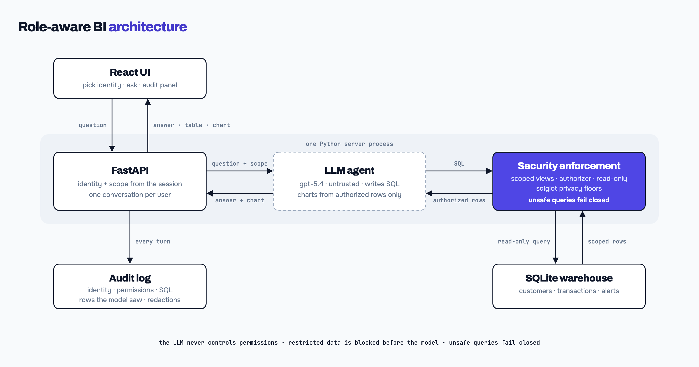

# Role-aware conversational BI



A chat interface over a small fraud-operations warehouse. You pick who you are, ask a question in plain language, and the agent answers with numbers, tables and charts. It only uses data that identity is allowed to see. The model writes SQL, but it never decides permissions, and restricted rows never reach it.

The original take-home brief is in [INSTRUCTIONS.md](INSTRUCTIONS.md). The write-up for reviewers, with the scorecard, findings, costs and AI log, is in [NOTES.md](NOTES.md).

## How access is enforced

| Layer | What it does | Code |
|---|---|---|
| Identity | Picking a user creates a server session. The model has no role parameter, so it can't claim one | `app/server.py`, `agent/policy.py` |
| Scoped views | Each table the user may see is a temp view that already filters rows (region, active customers) and drops columns they can't see | `agent/policy.py`, `agent/db.py` |
| Authorizer | A read-only connection that refuses raw tables, writes, PRAGMA and ATTACH. Limits of 2 s, 200 rows and 1 MB per value | `agent/db.py` |
| Privacy floors | sqlglot checks aggregates: at least 2 people, protected-class breakdowns need 10 people with 3 per cell, and fair_lending can't subtract two answers to isolate someone. Shapes it can't check fail closed | `agent/disclosure.py` |
| Charts | Built on the server from the last authorized query result. The model only names two columns | `agent/charts.py` |
| Audit | One JSON line per turn: identity, permissions, SQL, the rows the model saw, redactions. The UI gets a sanitized copy | `agent/audit.py` |

## The interface

- **Identity picker.** Switching starts a new session and conversation. It clears the thread, the panel and any draft, and drops any answer still in flight.
- **Thread with follow-ups.** Answers come with result tables, and with charts when you ask for one. Suppressed cells show as `<3`.
- **Distinct outcomes.** A refusal (amber, with the server's reason), an empty result ("no matching rows in your scope"), a clarifying question and an error each look different.
- **"What the agent did" panel.** Who the answer ran as, the permissions used, every query with its status, and anything refused or redacted.

The design write-up is in [docs/frontend.md](docs/frontend.md).

## Running it

Needs Python 3.10+ and Node 20.19+. Run everything from the repo root unless a step says otherwise.

**Setup, once.** The venv needs Python 3.10+. macOS's default `python3` may be 3.9. With a Python 3.12 on your PATH:

```bash
python3.12 -m venv .venv
source .venv/bin/activate
pip install -r requirements.txt
```

Or with [uv](https://docs.astral.sh/uv/), which fetches Python 3.12 itself:

```bash
uv venv --python 3.12 .venv
source .venv/bin/activate
uv pip install -r requirements.txt
```

Then:

```bash
python seed.py
cp .env.example .env
```

Then put your OpenAI key in `.env`.

**Backend, terminal 1.** Activate the venv in every new terminal:

```bash
source .venv/bin/activate
set -a && . ./.env && set +a
uvicorn app.server:app --port 8000
```

**Frontend, terminal 2:**

```bash
cd web
npm install
npm run dev
```

Open http://localhost:5173, pick an identity and ask a question. The dev server forwards `/api` to the backend on port 8000.

**One port instead.** Run `cd web && npm run build`, start the backend, and open http://localhost:8000. uvicorn serves the built UI itself.

## Results

| Check | Result |
|---|---|
| Model eval, correctness | 20/20 (baseline 11/18) |
| Model eval, leaks | 20/20 (baseline 12/17) |
| Consistency | 5 of 5 full runs clean on both gpt-5.4 and gpt-5.5 |
| Offline suites | scope 97/97, audit 6/6, charts 10/10, server 13/13, web 14/14 |
| Default model | gpt-5.4: $0.0086 per question, 1.9 s p50. gpt-5.5 is $0.0192 and 2.8 s |

To run them, with the venv active:
- `python eval/run_eval.py` runs the model eval and needs the key.
- `python eval/test_scope.py`, `test_audit.py`, `test_charts.py` and `test_server.py` run offline.
- `cd web && npm test` runs the frontend tests.

## Repo map

| Path | What it is |
|---|---|
| `agent/` | The agent loop (`baseline.py`), the permission table (`policy.py`), the database boundary (`db.py`), privacy floors (`disclosure.py`), charts and the audit record |
| `app/server.py` | FastAPI: sessions and the chat API |
| `web/` | The React UI |
| `eval/` | The model eval (`questions.yaml`, `leaks.yaml`) and the offline suites |
| `docs/` | [Backend now](docs/backend.md), [baseline review](docs/baseline.md), [frontend design](docs/frontend.md), [known limitations](docs/limitations.md), [AI log](docs/ai-log.md), [diagram source](docs/diagrams/architecture.html) |
| `seed.py` | Builds `fraud.db`, the fixture |

## Known limitations

- fair_lending can still isolate someone by combining three or more answers. Stopping that would need a query audit or noise on every answer.
- The audit file holds the rows the model saw, isn't tamper-evident, and has no retention policy.
- Sessions, history and the fair_lending population record live in process memory, so a restart clears them.

The full list is in [docs/limitations.md](docs/limitations.md).
